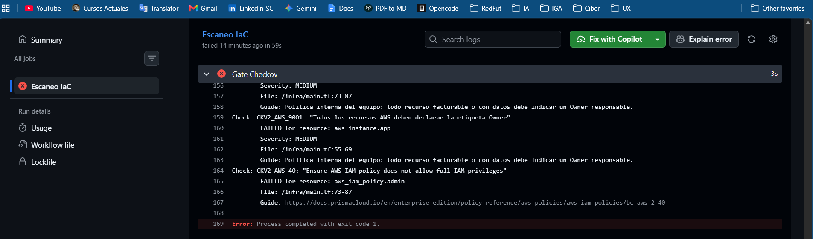
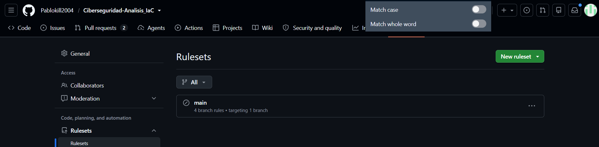
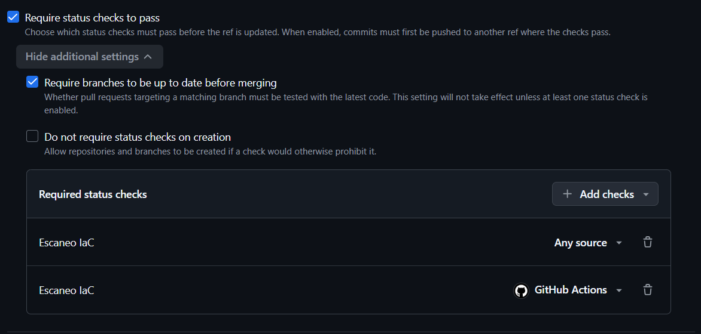

# Informe: Análisis de seguridad IaC en el pipeline

**Curso:** Ciberseguridad — Análisis de IaC
**Integrantes:** Pablo Siquinajay y Christian Sosa
**Repositorio:** <https://github.com/Pablokill2004/Ciberseguridad-Analisis_IaC>
**Fecha:** noviembre de 2026

---

## 1. Resumen ejecutivo

Se incorporó el análisis de seguridad de Infraestructura como Código (IaC) como
control automático del repositorio. La infraestructura de demostración se compone
de **Terraform (AWS)**, un **playbook de Ansible** y un **Dockerfile**; nada se
despliega, todo se analiza como código.

La línea base local arrojó **31 hallazgos de Checkov** (28 Terraform + 3 Dockerfile)
y **13 violaciones de ansible-lint** con el perfil `production`. El PR de
remediación corrigió **43 hallazgos/violaciones** agrupados por tipo de cambio,
dejó **una única excepción documentada** (`CKV_AWS_88`, con justificación,
aprobación y vencimiento) y dejó el pipeline en verde. El PR de prueba demostró
que un cambio inseguro (SSH abierto a `0.0.0.0/0`) es bloqueado por el job de
seguridad y por la protección de la rama `main`.

---

## 2. Línea base local

### 2.1 Entorno y versiones

| Herramienta | Versión | Notas |
|---|---|---|
| Checkov | `3.4.5` | Versión fijada en el pipeline |
| ansible-lint | `26.11.0` | Perfil `production` |
| ansible-core | `2.21.6` | Versión fijada en el pipeline |
| Python | 3.12.10 (local) / 3.13 (CI) | — |

> **Sobre las versiones fijadas:** el ejemplo de la consigna propone
> `ansible-core==2.22.0`, pero esa versión **no existe en PyPI** (la última
> disponible es 2.21.6). Se fijó `2.21.6` para que el pipeline sea reproducible.
> Las tres versiones se verificaron con `pip index versions` antes de fijarlas.

Comandos ejecutados:

```bash
checkov -d . --external-checks-dir politicas \
  --skip-path .venv --skip-path reportes --skip-path docs \
  --skip-path politicas --skip-path .github --compact

ansible-lint --profile production ansible/
```

> **Nota de plataforma:** ansible-lint no soporta Windows como controlador
> (`grp`, `fcntl`, `fork`). La línea base de Ansible se ejecutó en un contenedor
> Linux (`python:3.13-slim`) con las mismas versiones fijadas. En GitHub Actions
> el runner es `ubuntu-latest`, por lo que el pipeline no tiene esta limitación.

### 2.2 Conteo de fallas por tipo de archivo

| Tipo de IaC | Archivo | Fallas Checkov | Fallas ansible-lint |
|---|---|---|---|
| Terraform | `infra/main.tf` | **28** (26 IDs distintos) | — |
| Dockerfile | `docker/Dockerfile` | **3** | — |
| Ansible | `ansible/site.yml` | 0 | **13** |
| **Total** | — | **31** | **13** |

Resumen textual de Checkov en la línea base:

```text
terraform scan results:  Passed checks: 6,  Failed checks: 28, Skipped checks: 0
dockerfile scan results: Passed checks: 37, Failed checks: 3,  Skipped checks: 0
ansible scan results:    Passed checks: 2,  Failed checks: 0,  Skipped checks: 0
```

### 2.3 Los cinco hallazgos más graves

| # | ID | Recurso | Riesgo real |
|---|---|---|---|
| 1 | `CKV_AWS_62` | `aws_iam_policy.admin` | Política IAM con `Action: "*"` y `Resource: "*"`. Cualquier credencial que la use puede crear, borrar o modificar **todo** en la cuenta, incluidos usuarios y roles: equivale a un compromiso total de la cuenta y a escalamiento de privilegios. |
| 2 | `CKV_AWS_8` | `aws_instance.app` (EBS raíz) | Disco sin cifrar. Si se filtra un snapshot o el volumen, los datos quedan legibles sin llaves; incumple requisitos básicos de cifrado en reposo. |
| 3 | `CKV_AWS_79` | `aws_instance.app` | IMDSv1 habilitado. Una SSRF o una aplicación comprometida puede consultar `169.254.169.254` y robar las credenciales temporales del rol de la instancia para moverse lateralmente. |
| 4 | `CKV_AWS_88` | `aws_instance.app` | Instancia con IP pública: queda directamente expuesta a Internet, ampliando la superficie de ataque (escaneo, fuerza bruta, explotación directa). Es el hallazgo que se documenta como **excepción**. |
| 5 | `CKV_DOCKER_3` | `docker/Dockerfile` | La imagen no define `USER`, por lo que el contenedor corre como **root**. Un fallo de la aplicación o un escape de contenedor tiene impacto directo sobre el host y los volúmenes montados. |

Otros hallazgos relevantes de la línea base: `CKV_AWS_382` (egress irrestricto),
`CKV_AWS_260` (HTTP/80 abierto a Internet), `CKV_AWS_9`/`CKV_AWS_10` (política de
contraseñas débil, longitud mínima 6 y expiración a 365 días), `CKV2_AWS_5`
(Security Group no asociado a ningún recurso), `CKV2_AWS_41` (instancia sin rol
IAM) y `CKV_DOCKER_7` (imagen base `ubuntu:latest`).

### 2.4 Detalle de ansible-lint (13 violaciones)

| Regla | Cantidad | Qué implica |
|---|---|---|
| `fqcn` | 4 | Uso de módulos sin nombre totalmente calificado; riesgo de resolver un módulo inesperado. |
| `command-instead-of-module` | 2 | `apt-get` y `curl` ejecutados como comandos en lugar de módulos idempotentes. |
| `no-changed-when` | 2 | Tareas de comando que siempre reportan cambios. |
| `name[casing]` / `name[missing]` | 2 | Tareas/plays sin nombre o mal capitalizados (dificulta auditoría). |
| `yaml[truthy]` | 1 | `yes` en lugar de `true`. |
| `ignore-errors` | 1 | Errores silenciados, ocultando fallos reales. |
| `risky-shell-pipe` | 1 | `curl ... | bash` sin `pipefail`: ejecución remota de código sin control. |

---

## 3. Diseño del pipeline

Archivo: `.github/workflows/iac-security.yml`. Se dispara en cada
`pull_request` y en cada `push` a `main`.

| Paso | Momento | ¿Bloquea? | Qué hace |
|---|---|---|---|
| `Checkov - reporte SARIF` | Siempre | No (`--soft-fail`) | Genera `reportes/results_sarif.sarif` con los hallazgos. |
| `Publicar en Code Scanning` | Siempre (`if: always()`) | No | Sube el SARIF a **Security → Code scanning** con categoría `checkov`. |
| `Gate Checkov` | Después del reporte | **Sí** | Escanea sin `--soft-fail`; el código de salida distinto de 0 marca el job en rojo. |
| `Validar sintaxis de Ansible` | Después | **Sí** | `ansible-playbook ... --syntax-check`. |
| `Gate ansible-lint (production)` | Después | **Sí** | `ansible-lint --profile production ansible/`; falla si hay violaciones. |

Decisiones de diseño:

- **Versiones fijas** (`checkov==3.4.5`, `ansible-core==2.21.6`,
  `ansible-lint==26.11.0`): garantizan reproducibilidad, evitan que una
  actualización silenciosa cambie reglas o rompa el build y reducen el riesgo de
  supply chain. Además, `ansible-core==2.22.0` (ejemplo de la consigna) no existe
  en PyPI.
- **El reporte nunca bloquea; los gates sí.** `--soft-fail` se usa únicamente en
  el paso que genera SARIF. Ningún gate usa `--soft-fail` ni
  `continue-on-error`.
- **Un solo escaneo de Checkov.** En Checkov 3.4.5 pasar varios `-d` repetía el
  escaneo y duplicaba hallazgos en el SARIF. Por eso se escanea una vez la raíz
  con `-d .` y se excluyen con `--skip-path` los directorios que no son IaC
  (`.venv`, `reportes`, `docs`, `politicas`, `.github`).
- **Escaneo de los tres tipos de IaC:** Terraform, Ansible y Dockerfile.
- **SARIF en repositorios privados:** si el repo fuese privado sin GitHub
  Advanced Security, se reemplaza el paso de publicación por
  `actions/upload-artifact@v4` con `path: reportes/` (el job sube el SARIF como
  artifact descargable).

Protección de rama (`main`): *Settings → Rules → Rulesets* → exigir PR y marcar
**`Escaneo IaC`** como *status check* obligatorio, además de bloquear force
pushes.

---

## 4. Evidencia del gate que bloquea

**PR #1:** [RELLENA: enlace al PR #1]
**Rama:** `gate/prueba-bloqueo` — cambia el origen del SSH del Security Group de
`10.0.0.0/8` a `0.0.0.0/0`.

Qué ocurre:

1. El PR dispara `Seguridad IaC`.
2. El `Gate Checkov` falla con `CKV_AWS_24`
   (*Ensure no security groups allow ingress from 0.0.0.0:0 to port 22*).
3. ansible-lint también falla porque la línea base aún no está remediada.
4. La protección de rama impide el merge: el botón queda bloqueado
   (*Merging is blocked* / *Required status check "Escaneo IaC"*).
5. El PR se **cierra sin fusionar**.

Capturas:

- **PR con el check en rojo y el log del gate**

- **Recuadro de merge bloqueado**

-  **Ruleset**

- **Rama protegida mediante una verificacion obligatoria en 'Escaneo IaC'**


---

## 5. Evidencia SARIF

El workflow publica `reportes/results_sarif.sarif` en **Security → Code
scanning** con categoría `checkov`, incluso cuando el job falla (paso con
`if: always()`).

- [RELLENA: captura de Security → Code scanning con los hallazgos de Checkov]

Si Code Scanning no estuviera disponible (repo privado sin GHAS), el SARIF queda
como artifact del run (`reportes/`), descargable desde la página del workflow.

---

## 6. Remediación

**PR #2:** (https://github.com/Pablokill2004/Ciberseguridad-Analisis_IaC/pull/2)
**Rama:** `remediacion/hallazgos-checkov` — un commit por tipo de corrección.

### 6.1 Tabla antes/después

| ID(s) | Recurso | Cambio aplicado | Antes | Después |
|---|---|---|---|---|
| `CKV_AWS_382`, `CKV_AWS_260` | `aws_security_group.app` | Egress restringido a `10.0.0.0/8`; HTTP/80 solo desde la red corporativa (el SSH ya estaba restringido). | FAIL | PASS |
| `CKV_AWS_79` | `aws_instance.app` | `metadata_options.http_tokens = "required"` (IMDSv2 obligatorio). | FAIL | PASS |
| `CKV_AWS_8` | `aws_instance.app` | `root_block_device.encrypted = true`. | FAIL | PASS |
| `CKV_AWS_126` | `aws_instance.app` | `monitoring = true` (monitoreo detallado). | FAIL | PASS |
| `CKV_AWS_135` | `aws_instance.app` | `ebs_optimized = true`. | FAIL | PASS |
| `CKV_AWS_62`, `CKV_AWS_63`, `CKV_AWS_286`, `CKV_AWS_287`, `CKV_AWS_288`, `CKV_AWS_289`, `CKV_AWS_290`, `CKV_AWS_355`, `CKV2_AWS_40` | `aws_iam_policy.app` | Se reemplaza `Action: "*"` / `Resource: "*"` por `s3:GetObject` + `s3:ListBucket` sobre un bucket concreto (mínimo privilegio). | FAIL (9) | PASS (9) |
| `CKV2_AWS_5` | `aws_security_group.app` | El Security Group se asocia a la instancia con `vpc_security_group_ids`. | FAIL | PASS |
| `CKV2_AWS_41` | `aws_instance.app` | Se crean `aws_iam_role` + `aws_iam_instance_profile` y se asocian a la instancia. | FAIL | PASS |
| `CKV_AWS_9` … `CKV_AWS_15` | `aws_iam_account_password_policy.fuerte` | Longitud 14, reutilización 24, mayúsculas/minúsculas/números/símbolos obligatorios, expiración 90 días. | FAIL (7) | PASS (7) |
| `CKV2_AWS_9001` (política propia) | SG, instancia y política IAM | Etiquetas `Owner` y `Environment` en los recursos. | FAIL (3) | PASS (3) |
| `CKV_DOCKER_2`, `CKV_DOCKER_3`, `CKV_DOCKER_7` | `docker/Dockerfile` | Base `ubuntu:24.04` (no `latest`), usuario no-root `appuser`, `HEALTHCHECK` y limpieza de caché de APT. | FAIL (3) | PASS (3) |
| 13 reglas de ansible-lint | `ansible/site.yml` | FQCN, nombres en todas las tareas, `true` en lugar de `yes`, módulos idempotentes (`apt`, `copy`, `service`), sin `ignore-errors`, sin `curl | bash`, permisos explícitos `0644`. | FAIL (13) | PASS |
| `CKV_AWS_88` | `aws_instance.app` | **Excepción documentada** (ver §7). | FAIL | SKIP |

### 6.2 Resultado del escaneo tras la remediación

```text
terraform scan results:  Passed checks: 38, Failed checks: 0, Skipped checks: 1
dockerfile scan results: Passed checks: 58, Failed checks: 0, Skipped checks: 0
ansible scan results:    Passed checks: 4,  Failed checks: 0, Skipped checks: 0
```

```text
ansible-lint: Passed: 0 failure(s), 0 warning(s) ... Profile 'production' was required, and it passed.
```

Total corregido: **43 elementos** (27 hallazgos Terraform + 3 Dockerfile + 13
violaciones de ansible-lint), muy por encima del mínimo de 8. La única excepción
es `CKV_AWS_88`.

---

## 7. Excepción documentada (exactamente una)

Ubicación: `infra/main.tf`, recurso `aws_instance.app`.

```hcl
  # La instancia publica un servicio web de laboratorio y necesita IP publica.
  # Control compensatorio: el Security Group solo expone 80/443 y el SSH queda
  # limitado a 10.0.0.0/8. Aprobado por el responsable de seguridad
  # (referencia SEC-2026-014); la excepcion vence el 2026-12-31.
  #checkov:skip=CKV_AWS_88:IP publica requerida por el servicio de laboratorio; acceso restringido por Security Group; aprobado en SEC-2026-014, vence 2026-12-31.
  associate_public_ip_address = true
```

| Campo | Valor |
|---|---|
| Control | `CKV_AWS_88` — la instancia no debe tener IP pública |
| Justificación | El servicio de laboratorio debe ser alcanzable desde fuera de la VPC; se mantiene una sola IP pública. |
| Controles compensatorios | Security Group limitado a la red corporativa en SSH y HTTP, IMDSv2 obligatorio, disco cifrado, monitoreo detallado y rol IAM de mínimo privilegio. |
| Referencia de aprobación | `SEC-2026-014` — Pablo Siquinajay |
| Vencimiento | `2026-12-31` (se revisa o se retira la excepción antes de esa fecha) |
| Quién debe aprobarlo | Responsable de seguridad de la información o líder técnico del equipo, nunca el autor del cambio. |

Por qué es aceptable: el riesgo residual es **exposición directa a Internet**, no
un acceso irrestricto; los puertos y rangos están acotados y el resto de los
controles de la instancia están endurecidos. La excepción es **temporal**,
auditable (referencia y fecha en el propio código) y **única**:
`git grep -n "checkov:skip" -- infra/` devuelve una sola coincidencia.

---

## 8. Política propia de Checkov

Archivo: `politicas/politica_etiqueta_owner.yaml`. Regla de la organización:
**todo recurso AWS relevante debe declarar la etiqueta `Owner`** para saber a
quién se reporta un incidente o un costo.

```yaml
metadata:
  version: "1.0"
  id: "CKV2_AWS_9001"
  name: "Todos los recursos AWS deben declarar la etiqueta Owner"
  category: "CONVENTION"
  severity: "MEDIUM"
  guideline: "Politica interna del equipo: todo recurso facturable o con datos debe indicar un Owner responsable."
definition:
  cond_type: "attribute"
  resource_types:
    - "aws_security_group"
    - "aws_instance"
    - "aws_iam_policy"
  attribute: "tags.Owner"
  operator: "exists"
```

Integración en el pipeline: `--external-checks-dir politicas` en los pasos de
Checkov (reporte y gate). La política es YAML nativo de Checkov ("YAML Custom
Policies", bloques `metadata` + `definition`).

- **Caso que falla:** la línea base (y el PR #1) tiene 3 hallazgos
  `CKV2_AWS_9001`, uno por cada recurso sin `tags.Owner`.
- **Caso que pasa:** tras la remediación, los tres recursos declaran
  `Owner = "equipo-iac"` y la política pasa (0 hallazgos de `CKV2_AWS_9001`).

---

## 9. Conclusiones

### 9.1 Qué no detectaron las herramientas

- **Lógica de negocio y flujos de datos:** Checkov valida atributos estáticos,
  no si una arquitectura concreta permite un abuso funcional.
- **Permisos IAM efectivos en tiempo real:** analiza la política declarada, no
  las políticas adjuntas, límites de permisos ni condiciones de sesión.
- **Deriva (drift) y estado real:** no compara con lo desplegado; un cambio
  manual fuera del repositorio no se detecta.
- **Vulnerabilidades de imágenes y dependencias:** `ubuntu:24.04` puede tener
  CVEs; hace falta un escáner de imágenes (`trivy`, `grype`).
- **Secretos en el historial de Git:** Checkov no reemplaza un escáner de
  secretos dedicado (`gitleaks`, `trufflehog`).
- **Alcance de red real:** no valida rutas, NACLs, balanceadores ni exposición
  efectiva a Internet.
- **Excepciones y su vigencia:** el `skip` es texto; sin un proceso que lo
  revise, puede quedar vigente para siempre.

Cómo se cubriría: CSPM/escaneo en runtime, `trivy` para imágenes, `gitleaks`
para secretos, AWS IAM Access Analyzer para permisos efectivos, detección de
drift (`terraform plan` en CI) y revisión periódica de excepciones con
vencimiento automático.

### 9.2 Uso de IA

Se utilizó una herramienta de IA (OpenCode con modelo DeepSeek) como apoyo para
redactar el informe, generar la IaC de demostración y proponer las correcciones.
Todas las decisiones, comandos y resultados fueron revisados y ejecutados por
los integrantes; no se incluyó información sensible ni credenciales.

---

## Anexo A — Estructura del repositorio

```text
.
├── .github/workflows/iac-security.yml
├── .ansible-lint
├── infra/main.tf
├── ansible/site.yml
├── ansible/inventory.ini
├── ansible/files/nginx.conf
├── docker/Dockerfile
├── docker/app.sh
├── politicas/politica_etiqueta_owner.yaml
├── docs/informe.md
└── docs/PASOS_PENDIENTES.md
```

## Anexo B — Cómo reproducir

```bash
python -m venv .venv
source .venv/bin/activate        # Windows: .venv\Scripts\activate
pip install checkov==3.4.5 ansible-core==2.21.6 ansible-lint==26.11.0

checkov -d . --external-checks-dir politicas \
  --skip-path .venv --skip-path reportes --skip-path docs \
  --skip-path politicas --skip-path .github --compact

ansible-lint --profile production ansible/
```

En Windows, ansible-lint debe ejecutarse en WSL o en un contenedor Linux
(por ejemplo `python:3.13-slim`); el pipeline de GitHub usa `ubuntu-latest`.
